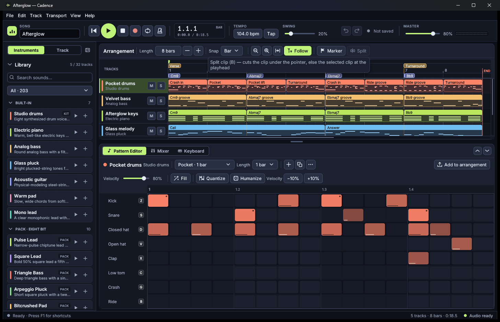
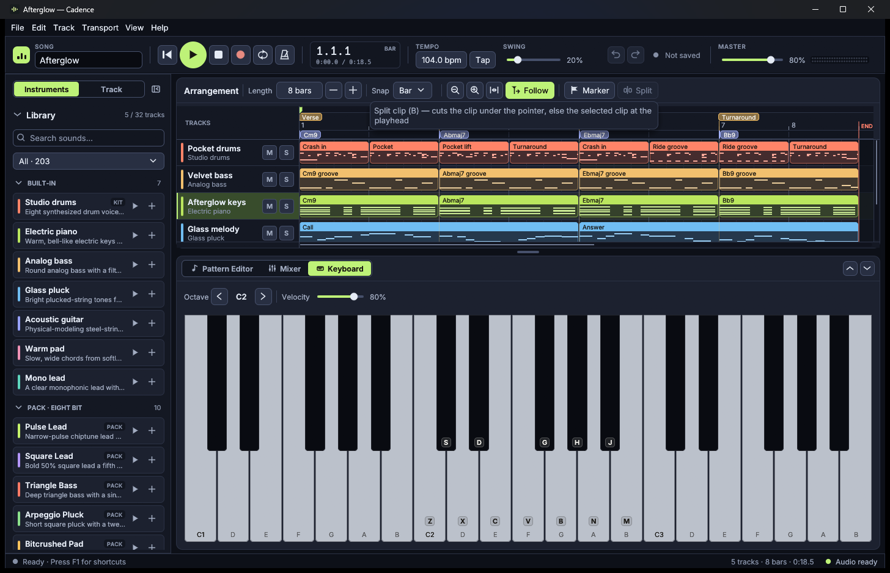

<div align="center">

# Cadence

**A focused songwriting studio for electronic musicians — native, offline, and yours.**

[](https://github.com/Toom68/cadence/releases/latest)
[](https://github.com/Toom68/cadence/releases/latest)
[](https://github.com/Toom68/cadence/releases/latest)
[](https://github.com/Toom68/cadence/actions)



</div>

Cadence is a multi-track music-making app for Windows and macOS, written in Rust. Write drum patterns and melodies in a step sequencer and piano roll, arrange them into songs on a timeline, drop imported WAVs onto audio lanes, mix with per-track effects and subgroup buses, and export WAV, per-track stems, or MIDI.

- **203 bundled instruments** — chiptune, psy-experimental banks, drum kits, guitars, neon leads, one-shot FX, mallets & keys — plus a built-in General MIDI SoundFont (all 128 GM programs, sampled — GeneralUser GS), more `.sf2` SoundFonts, JSON instrument packs, and `.wav` sample import
- **Play and record from a MIDI keyboard** — plug in any USB/class-compliant controller (or use the computer keyboard): notes play the selected track with their velocity and record into its pattern, sustain pedal included; hot-plugging is followed automatically
- **Audio lanes** for your own WAV clips — move, loop, and fade them like pattern clips
- **A real mixer** — per-track volume/pan/mute/solo, FX, subgroup buses, live peak meters
- **Local-first and offline** — songs are plain `.cadence` JSON files; crash recovery and autosave protect your work. No account, no subscription, no telemetry
- **Keeps itself up to date** — install once; new versions download, get signature-checked and install with one click
- **Native and fast** — pure-Rust synthesis on a real-time audio engine; no Electron, no web runtime

## Download

Get the latest build from **[Releases](https://github.com/Toom68/cadence/releases/latest)** — no build tools needed:

| Platform | File | Notes |
| --- | --- | --- |
| **Windows 10+ (x64)** | `Cadence-*-windows-x64-setup.exe` | Installs for your user account — no admin prompt. Start menu entry, double-click `.cadence` songs, uninstall from Settings → Apps |
| **macOS 11+ (Apple Silicon + Intel)** | `Cadence-*-macos-universal.dmg` | Drag Cadence into **Applications** |
| Windows, portable | `Cadence-*-windows-x64.zip` | Unzip anywhere and run `Cadence.exe` — no automatic updates |

**First launch:** the builds are not code-signed yet. On Windows, SmartScreen may warn once — **More info → Run anyway**. On macOS, right-click Cadence and choose **Open** the first time.

**Updates:** once installed, Cadence checks for a new version each time it opens (and once a day while it stays open) and shows an update button in the status bar. One click downloads it, verifies its signature against the release key built into the app, and installs it when you restart (or when you quit); the Update dialog shows the release notes and the download's progress, with a Cancel button. If an update doesn't finish installing, the next launch says so and links the release page. Turn the automatic check off in **Help → Check for Updates…** — it only asks github.com for the newest version number; nothing about you or your songs is sent.

An audio output device is needed to hear playback; editing, saving and WAV export work without one, and Cadence picks up a device that appears later. Pick your output from the audio indicator in the status bar.

## Screenshots

<table>
  <tr>
    <td></td>
    <td></td>
  </tr>
</table>

*One of three built-in themes (Midnight, Graphite, Paper).*

## Build from source

Requires a stable Rust toolchain via [rustup](https://rustup.rs). If `cargo` isn't on your PATH: `export PATH="$HOME/.cargo/bin:$PATH"` (`cargo --version` should work).

## Quick start

```bash
cargo run            # build and launch the Cadence window
```

On first launch Cadence opens the included demo song, *Afterglow*. If a valid recovery copy exists it offers to restore it instead.

## Commands

| Command | What it does |
| --- | --- |
| `cargo build` | Debug build → `target/debug/cadence` |
| `cargo run` | Build and launch the GUI |
| `cargo build --release` | Optimized build → `target/release/cadence` |
| `cargo test --locked --all-targets` | Run unit and integration tests |
| `cargo fmt --all -- --check` | Verify formatting |
| `cargo clippy --locked --all-targets -- -D warnings` | Lint |
| `scripts/mac-package.sh` | macOS package: `Cadence.app`, `.zip`, and `.dmg` when `hdiutil` is available |
| `scripts/windows-package.ps1` | Windows package on Windows: release `Cadence.exe`, a portable `.zip`, and the `-setup.exe` installer when [Inno Setup 6](https://jrsoftware.org/isinfo.php) is installed |
| `scripts/fetch-soundfont.sh` | Download + SHA-256-verify the built-in GM SoundFont into `.cache/soundfonts` (run once; `cargo run` then finds it). The packaging scripts call it; `fetch-soundfont.ps1` is the Windows twin |
| `scripts/windows-cross-package.sh` | Windows x64 package from macOS/Linux via the GNU target (needs `mingw-w64` and `rustup target add x86_64-pc-windows-gnu`; installs nothing itself) |

`Cargo.lock` is committed — build and test with `--locked` for reproducible results (as CI does). Package artifacts land in `dist/`: `Cadence-<version>-macos-<arch>.{zip,dmg}`, `Cadence-<version>-windows-x64.zip` (containing `Cadence.exe`) and `Cadence-<version>-windows-x64-setup.exe`. Two Windows paths exist: `windows-package.ps1` builds the native MSVC binary on Windows (the CI path), while `windows-cross-package.sh` cross-builds the GNU-target exe on macOS/Linux. Both scripts honor `CARGO_TARGET_DIR` and copy the bundled font licenses into `licenses/` plus a buyer `README.txt`, `THIRD-PARTY-NOTICES.txt` (every crate and bundled font license, also browsable in-app via Help → About → Third-Party Notices) and `EULA.txt` when one exists at the repo root — the scripts warn when it is missing. Regenerate the notices after dependency changes with `python scripts/gen-third-party-notices.py`. Packages are **not distribution-signed** (macOS ad-hoc, Windows unsigned). The native MSVC Windows package has been launched on Windows 11 (demo opened with audio ready, clean exit); a full human acceptance pass on Windows is still outstanding — see Limitations and [docs/verification.md](docs/verification.md).

`scripts/mac-package.sh` also accepts `UNIVERSAL=1` (arm64 + x86_64 universal binary via `lipo`) and `SKIP_DMG=1` (zip only).

Every package also carries the built-in General MIDI SoundFont, `soundfonts/Cadence GM.sf2` (GeneralUser GS 2.0.3, ~31 MB, with its license) — inside `Cadence.app/Contents/Resources/` on macOS, next to `Cadence.exe` on Windows. It is not in git: the scripts fetch it from a pinned URL and verify its SHA-256 (see [packaging/soundfont/README.md](packaging/soundfont/README.md)). Offline local packaging warns and ships without it; `REQUIRE_SOUNDFONT=1` (set in CI) makes that an error, and a checksum mismatch always is.

### Headless / CLI modes

The `cadence` binary also runs without the GUI — useful for rendering and validation in scripts and CI:

```bash
cadence --render-demo output.wav              # render the built-in demo song to WAV
cadence --render song.cadence output.wav      # render a saved project to WAV
cadence --render-stems song.cadence out_dir/  # render every audible track to its own WAV
cadence --check song.cadence                  # validate a project file and print a summary
cadence song.cadence                          # open the app with a song
cadence --check-update                        # ask the release feed for a newer version
cadence --version / --help                    # version and usage

# Instrument packs (JSON synth presets — see packs/README.md)
cadence --new-pack my-synths pack.json    # write a starter pack template
cadence --validate-pack pack.json         # check a pack file
cadence --install-pack pack.json          # install into the user pack folder
cadence --list-instruments                # list built-in + installed instruments
```

## Using Cadence

The short version: the app opens on the demo song — press **play** to hear it, pick a track in the sidebar, write or edit patterns in the pattern editor (drum step grid or piano roll), arrange pattern and audio clips on the timeline, set tempo/swing/song length, then mix and export.

The window is a menu bar (File · Edit · Track · Transport · View · Help), a transport bar (song name, playback buttons, position display, tempo/tap, swing, master volume and meters, undo/redo), an instrument sidebar on the left, the arranger on top, and a tabbed editor below — **Pattern Editor | Mixer | Keyboard** — with a draggable divider between the two panels. A status bar at the bottom reports save state, audio state and export progress, with toasts for outcomes.

See [docs/songwriting-workflow.md](docs/songwriting-workflow.md) for the full walkthrough, [docs/project-files.md](docs/project-files.md) for saving/recovery/`.cadence` format, and [docs/export.md](docs/export.md) for WAV, stems and MIDI details.

## Keyboard shortcuts

Shortcuts are app-wide (⌘ on macOS, Ctrl on Windows). Press **F1** in the app for the built-in shortcuts & tips dialog.

| Shortcut | Action |
| --- | --- |
| Space | Play / pause |
| Home | Return to start |
| L | Toggle loop |
| R | Toggle record (MIDI/step recording into the selected track's pattern) |
| B | Split the clip at the pointer / playhead (arranger) |
| ⌘/Ctrl + N | New Song |
| ⌘/Ctrl + O | Open… |
| ⌘/Ctrl + S | Save |
| ⌘/Ctrl + Shift + S | Save As… |
| ⌘/Ctrl + E | Export WAV… |
| ⌘/Ctrl + Q | Quit |
| ⌘/Ctrl + Z | Undo |
| ⌘/Ctrl + Shift + Z (or ⌘/Ctrl + Y) | Redo |
| ⌘/Ctrl + D | Duplicate selection |
| ⌘/Ctrl + C / X / V | Copy / cut / paste selection (notes, clips, or a whole track) at the playhead |
| ⌘/Ctrl + A | Select all notes or arranger clips (based on focus) |
| Delete / Backspace | Delete selection |
| Esc | Deselect / close dialog |
| Arrow keys | Nudge selection (Shift+↑/↓ nudges by octave) |
| = / − | Zoom in / out |
| ⌘/Ctrl + 1 / 2 / 3 | Pattern Editor / Mixer / Keyboard tab |
| ⌘/Ctrl + Shift + ↑ / ↓ | Maximize the editor / the arranger (again to restore) |
| F1 | Shortcuts & tips |

The **File** menu also has *Open Recent*, *Save Copy with Audio…* (the song plus a folder with every WAV it uses, for moving it to another computer), *Clean Up Unused Audio…* (asks before deleting imported WAVs no open, autosaved or recent song uses), *Preferences…* (⌘/Ctrl+,: theme, audio output, MIDI input, automatic update checks), *New from Demo*, the imports (*MIDI*, *Audio File*, *Sample*, *Instrument Pack*) and the exports (*WAV*, *Stems*, *MIDI*); **Edit** adds *Split Clip at Playhead*, *Add Marker at Playhead*, *Quantize Notes*, *Humanize Notes* and *Arpeggiator…*; **Track** adds, duplicates, deletes and reorders tracks (including audio tracks); **Transport** holds Play/Stop/Loop/Record/Metronome; **View** holds the tabs, zoom, *Fit Song in Arranger*, *Follow Playhead*, the panel sizes (drag or double-click the divider between the arranger and the editor too) and *Theme* — Graphite (default), Midnight, or Paper — which recolors the whole interface and is remembered between sessions. You can also drop files on the window: songs open, `.mid` files import, WAVs land on new audio tracks, `.json` packs and `.sf2` SoundFonts install.

## Export

- **File → Export WAV…** renders the current mix (honoring mute/solo, buses and master volume) to a `.wav` file on a background thread with progress.
- **File → Export Stems…** renders every audible track to its own `<track name>-NN.wav` in a folder you pick — the same per-track signal it contributes to the mix.
- **File → Export MIDI…** writes the song's notes to a `.mid` file for use in other DAWs; **File → Import MIDI…** brings an existing `.mid`/`.midi` back in as a project.

Details and limitations: [docs/export.md](docs/export.md).

## Packaging

- `scripts/mac-package.sh` builds `dist/Cadence.app` (ad-hoc signed, icon included), a `.zip`, and a `.dmg` when `hdiutil` is present; `UNIVERSAL=1` produces a universal binary.
- `scripts/windows-package.ps1` (or `pwsh scripts/windows-package.ps1`) builds `dist/Cadence-<version>-windows-x64/Cadence.exe` — a GUI-subsystem exe with the MSVC CRT statically linked, so the portable zip needs no redistributable — plus the `.zip` and, with Inno Setup 6, `Cadence-<version>-windows-x64-setup.exe` from [`packaging/windows/cadence.iss`](packaging/windows/cadence.iss): a per-user install into `%LOCALAPPDATA%\Programs\Cadence` (never an admin prompt, so updates install silently), Start menu entry, optional desktop icon, `.cadence` file association, and an uninstaller. CI installs and uninstalls it on every push as a smoke test.

Packaging is honest: macOS bundles are **ad-hoc signed only** (no Developer ID, not notarized) and Windows executables and the installer are **unsigned** — no Authenticode certificate. Distributing these builds may trigger platform security prompts. Updates are a separate matter: they are signed with the project's own release key (below), which Cadence checks before installing anything.

## Releasing

Pushing a version tag makes CI build and test both platforms, sign every download, and publish a GitHub release with the `latest.json` manifest that installed copies read ([`src/update.rs`](src/update.rs)).

**One-time setup — the update signing key.** [minisign](https://jedisct1.github.io/minisign/) is free. In PowerShell (macOS: `brew install minisign`):

```powershell
winget install jedisct1.minisign          # then open a new terminal
minisign -G -W -f -p packaging/update-key.pub -s "$HOME\cadence-release.key"
Get-Content -Raw "$HOME\cadence-release.key" | gh secret set MINISIGN_SECRET_KEY -R Toom68/cadence
git add packaging/update-key.pub; git commit -m "Add the update signing key"; git push
```

Keep `cadence-release.key` out of the repo and back it up (a password manager is ideal): every installed copy trusts only that key, so losing it means users must reinstall by hand to get later updates.

**Each release:**

1. On an up-to-date, clean `main`: `scripts/release.sh 1.2.3 "what changed"` (add `--notes notes.md` for a longer what's-new text). It bumps `Cargo.toml` and `Cargo.lock`, runs `cargo fmt --check`, clippy and the full test suite, and commits `1.2.3: what changed` — or stops and undoes the bump if a check fails.
2. Run the commands it prints (`git push origin HEAD:main && git tag -a v1.2.3 -m … && git push origin v1.2.3`), or pass `--push` to step 1 to run them directly. The tag must match `Cargo.toml`; its message is shown in the app's Update dialog as the release notes.
3. CI publishes the release. Installed copies offer it within a day, or at once via **Help → Check for Updates…**.

## Project files

A `.cadence` file is a plain-text JSON document describing tempo, swing, song length, key, section markers, chord events, buses, and every track/pattern/clip/note. Cadence validates files on open and keeps a local recovery copy so unsaved work survives crashes. Imported WAV clips live in a per-install audio store the project references by name — see [docs/project-files.md](docs/project-files.md).

## Limitations

- **Built-in synthesizers, JSON packs and SoundFonts — no binary plugin hosting yet.** Sounds are synthesized in-app (seven built-in timbres, 196 bundled pack presets across thirteen banks, optional user-installed JSON packs), sampled from the built-in General MIDI SoundFont or user-installed `.sf2` SoundFonts, or embedded as small WAV clips — see [docs/instrument-packs.md](docs/instrument-packs.md) and [packs/README.md](packs/README.md). Loading VST3/AU/CLAP plugins is a designed-but-unimplemented roadmap item; Cadence does **not** load them today.
- **Packages are not distribution-signed.** macOS builds are ad-hoc signed only and Windows builds are unsigned — no Developer ID, notarization, or Authenticode, so platform security warnings (Gatekeeper, SmartScreen) can appear when sharing builds. The native MSVC Windows package has been launched on Windows 11 (demo with audio ready, clean exit, GUI screenshot-swept in all three themes); a full human acceptance pass and audio-device hot-plug on Windows are still unverified. Windows 10+ is the expected target per Rust's platform support.
- **No audio recording.** Cadence is a pattern-based sequencer — you compose notes and drop in finished WAV files; you don't record takes. MIDI recording from a hardware MIDI controller, the computer keyboard or the Keyboard tab exists (the record button or **R**), writing notes into the selected track's pattern. Controller notes audition the track as short fixed-length previews (like computer keys) — how long you hold a key and the sustain pedal shape the *recorded* note lengths, not the live preview. MIDI input carries notes, velocity and the sustain pedal only; pitch bend, mod wheel and other controllers are ignored. Controller input has been exercised on macOS (CoreMIDI, including hot-plug) with a virtual device; Windows (WinMM) and Linux (ALSA) use the same `midir` code path but are unverified with real hardware.
- **Audio clips are per-install.** Imported WAVs are staged into the app's audio store and referenced by content-hash name; a `.cadence` file does not embed the audio. To move a song with audio to another computer use **File → Save Copy with Audio…**, which writes a `<song> Audio` folder beside it that Cadence picks up on open.
- Fixed sixteenth-note grid (1/16 snap); positions are stored in sixteenth steps.
- Swing amount up to 0.6, tempo 30–300 BPM, 1–128 bars per song, up to 32 tracks, four fixed subgroup buses.

## Documentation

| Document | Contents |
| --- | --- |
| [docs/songwriting-workflow.md](docs/songwriting-workflow.md) | Step-by-step guide to writing a song in Cadence |
| [docs/project-files.md](docs/project-files.md) | `.cadence` JSON format, save/open, recovery, audio store, validation limits |
| [docs/export.md](docs/export.md) | WAV, stems and MIDI export/import behavior and caveats |
| [docs/instrument-packs.md](docs/instrument-packs.md) | JSON instrument packs: make, install, and where they live |
| [docs/architecture.md](docs/architecture.md) | How the Rust crate, audio engine, model, and GUI fit together |
| [docs/verification.md](docs/verification.md) | What has actually been verified — test results, native run evidence, limits |
| [docs/acceptance-checklist.md](docs/acceptance-checklist.md) | Manual acceptance checklist for verifying a build |

## Architecture at a glance

Single Rust crate `cadence-studio` — library `cadence_studio`, binary `cadence`:

```
src/main.rs        window setup, CLI modes (song open, --render*/--check, packs)
src/lib.rs         module wiring
src/model.rs       Project/Track/Pattern/Clip/Note/AudioClip/Bus data model + validation
src/audio/         CPAL playback engine, synth voices, mixer/FX, WAV & stem renderer
src/midi.rs        Standard MIDI File import/export (midly)
src/midi_in.rs     hardware MIDI controller input (midir): parsing, sustain, hot-plug
src/packs.rs       JSON instrument packs (validate, catalog, install)
src/font.rs        SoundFont (.sf2) instruments: built-in + user font dirs, GM program names, catalog
src/gui/           eframe/egui interface: shell (menus/status/toasts), transport,
                   sidebar, arranger, editors, mixer, dialogs, theme
src/persistence.rs .cadence save/load, atomic writes, recovery autosave, audio store
src/update.rs      signed in-app updates: release manifest, minisign check, installer hand-off
packaging/         buyer README, Windows installer script, update key, release notes
packs/             bundled instrument packs (embedded via include_str!)
tools/instrument-packs/  agent guide for authoring new packs as pure JSON
```

Everything runs in-process: the GUI drives the audio engine through a shared `Project`, playback renders on the CPAL callback, and file I/O stays on the UI thread's worker paths. Full details in [docs/architecture.md](docs/architecture.md).

UI fonts: [Inter](https://rsms.me/inter/) 4.1 (SIL Open Font License 1.1) and [DejaVu Sans](https://dejavu-fonts.github.io/) 2.37 for symbols (Bitstream Vera license), bundled in `assets/fonts/` with their license texts.
